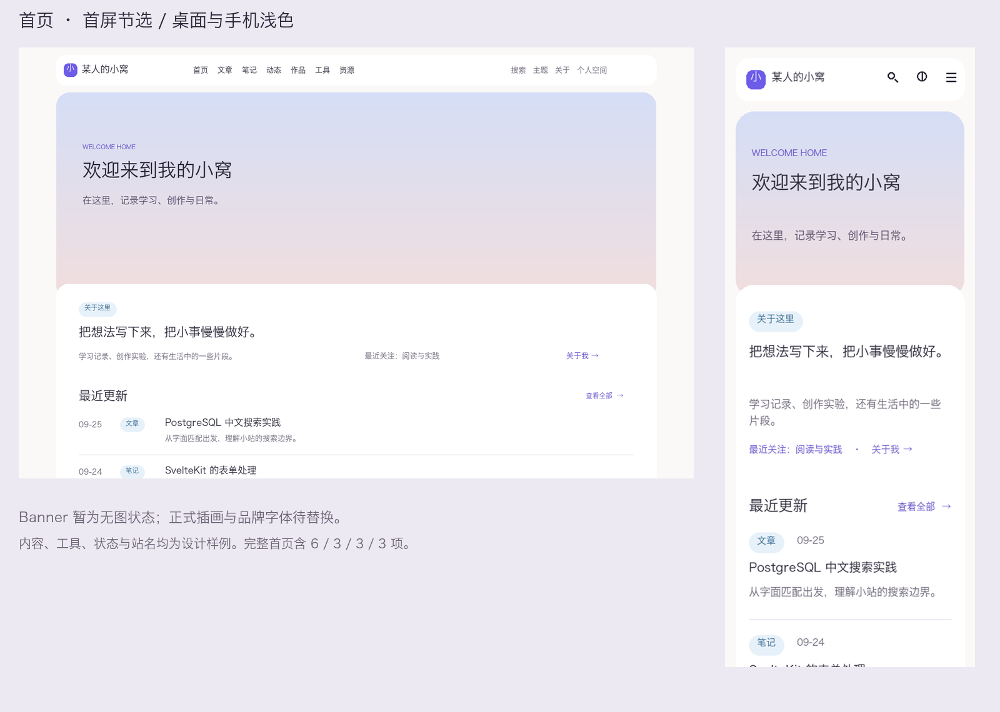

# 个人综合站：静态视觉稿 v1 审阅索引

日期：2026-09-25。状态：可视设计审阅稿，未批准实施。共 12 类页面/状态 × 桌面/手机 × 浅/深主题 = 48 张 PNG。没有创建网站项目、产品代码、依赖或部署；图片由本机现有绘图环境排版输出，非运行中的网站截图。

## 建议阅读顺序

先看首页完整长图的分区比例，再看文章详情的阅读密度，最后看编辑、发布、冲突与媒体的操作层级。首屏节选和缩略总览仅用于比较，具体文字应打开原尺寸图。

[首页全量四版总览](visual-v1/overview-home.png) · [公开页首屏总览](visual-v1/overview-public.png) · [工作台首屏总览](visual-v1/overview-workspace.png)

## 原尺寸画板

桌面布局宽 1440，手机布局宽 375；手机图片导出为 2 倍尺寸便于查看，不能把 750 像素文件误认为 750px 平板设计。页面高度随内容变化。

| 页面/状态 | 桌面浅色 | 桌面深色 | 手机浅色 | 手机深色 |
|---|---|---|---|---|
| 首页完整长图 | [查看](visual-v1/home-desktop-light.png) | [查看](visual-v1/home-desktop-dark.png) | [查看](visual-v1/home-mobile-light.png) | [查看](visual-v1/home-mobile-dark.png) |
| 文章详情（评论失败） | [查看](visual-v1/detail-desktop-light.png) | [查看](visual-v1/detail-desktop-dark.png) | [查看](visual-v1/detail-mobile-light.png) | [查看](visual-v1/detail-mobile-dark.png) |
| 搜索结果 | [查看](visual-v1/search-desktop-light.png) | [查看](visual-v1/search-desktop-dark.png) | [查看](visual-v1/search-mobile-light.png) | [查看](visual-v1/search-mobile-dark.png) |
| 搜索空结果 | [查看](visual-v1/search-empty-desktop-light.png) | [查看](visual-v1/search-empty-desktop-dark.png) | [查看](visual-v1/search-empty-mobile-light.png) | [查看](visual-v1/search-empty-mobile-dark.png) |
| 搜索失败 | [查看](visual-v1/search-error-desktop-light.png) | [查看](visual-v1/search-error-desktop-dark.png) | [查看](visual-v1/search-error-mobile-light.png) | [查看](visual-v1/search-error-mobile-dark.png) |
| 工作台概览 | [查看](visual-v1/workspace-desktop-light.png) | [查看](visual-v1/workspace-desktop-dark.png) | [查看](visual-v1/workspace-mobile-light.png) | [查看](visual-v1/workspace-mobile-dark.png) |
| 内容管理列表 | [查看](visual-v1/content-list-desktop-light.png) | [查看](visual-v1/content-list-desktop-dark.png) | [查看](visual-v1/content-list-mobile-light.png) | [查看](visual-v1/content-list-mobile-dark.png) |
| Markdown 编辑器 | [查看](visual-v1/editor-desktop-light.png) | [查看](visual-v1/editor-desktop-dark.png) | [查看](visual-v1/editor-mobile-light.png) | [查看](visual-v1/editor-mobile-dark.png) |
| 发布与原排期处理 | [查看](visual-v1/publish-desktop-light.png) | [查看](visual-v1/publish-desktop-dark.png) | [查看](visual-v1/publish-mobile-light.png) | [查看](visual-v1/publish-mobile-dark.png) |
| 编辑冲突 | [查看](visual-v1/conflict-desktop-light.png) | [查看](visual-v1/conflict-desktop-dark.png) | [查看](visual-v1/conflict-mobile-light.png) | [查看](visual-v1/conflict-mobile-dark.png) |
| 媒体库 | [查看](visual-v1/media-desktop-light.png) | [查看](visual-v1/media-desktop-dark.png) | [查看](visual-v1/media-mobile-light.png) | [查看](visual-v1/media-mobile-dark.png) |
| 站长登录 | [查看](visual-v1/login-desktop-light.png) | [查看](visual-v1/login-desktop-dark.png) | [查看](visual-v1/login-mobile-light.png) | [查看](visual-v1/login-mobile-dark.png) |

## 这次可审阅的内容

- 首页是完整 6 条更新、3 篇精选、3 件作品、3 个工具；主面板只在 Banner 下重叠一次，作品与工具分区独立。
- 桌面精选一主两次，作品大图分行，工具紧凑列表；手机纵向重排，没有简单缩放桌面。
- 浅深主题语义色、阅读区与工作台密度、移动编辑标签、发布排期后果及冲突恢复层级均已可见。
- 搜索成功、空结果和失败分别成图，失败不会伪装成 0 条；工作台显示人工服务状态与独立异地恢复点。

## 仍是占位、不能据此验收的部分

1. Banner 使用已经约定的无图渐变状态；当前没有正式授权的日系场景图，未验证场景氛围、焦点裁切或图片叠字。作品/精选图片也是中性预览占位，不是实际作品截图。
2. 本机渲染使用 Hiragino Sans GB 字体替代目标 Noto Sans SC，英文与代码也尚未装入目标字体。字形/字重、真实浏览器抗锯齿与最终行长仍待目标字体版本验证。
3. 站名、内容、工具及运行数据均为虚构设计样例，不表示已创建工具或读取了真实服务器状态。
4. 图片展示静态排版，无法证明菜单、键盘焦点、触控、屏幕阅读器、输入法、滚动恢复和断点切换有效。未运行浏览器/产品测试。
5. 本批覆盖核心画面，不是所有路由和组件状态的最终全量设计：平板/320px 边界、手机菜单、完整站点设置/账号安全/系列排序等仍需补图；作品、资源、关于等专页仍以既有线框规则为依据。
6. 少数说明字段以静态文字表达，后续需在控件细稿中补齐输入、选择及焦点态；媒体处理状态不代表有真实上传任务。

## 本轮检查记录

- 所有 48 张 PNG 已逐文件解码，并校验与清单记录的尺寸相符。
- 目视检查：首页四版总览、公开页/工作台浅深首屏总览；另打开手机发布、深色编辑、工作台、深色冲突及搜索图检查文字与按钮位置。
- 发现并修正：搜索正常/失败混排，拆成独立画板；搜索示例改为全部标签以匹配结果；Banner 底部占位注记会被重叠面板遮住，已移出页面；冲突画面补回明确后续动作。
- 这些检查只支持已检查静态画面的审阅，不等同于所有画板在全部尺寸通过无障碍与交互验收。

## 后续

先根据这组可见画面收敛整体密度、主次与阅读舒适度，再补剩余画板与正式素材。所有设计材料最终合并为待批准正式规格；只有用户明确批准完整正式规格才进入 writing-plans。

