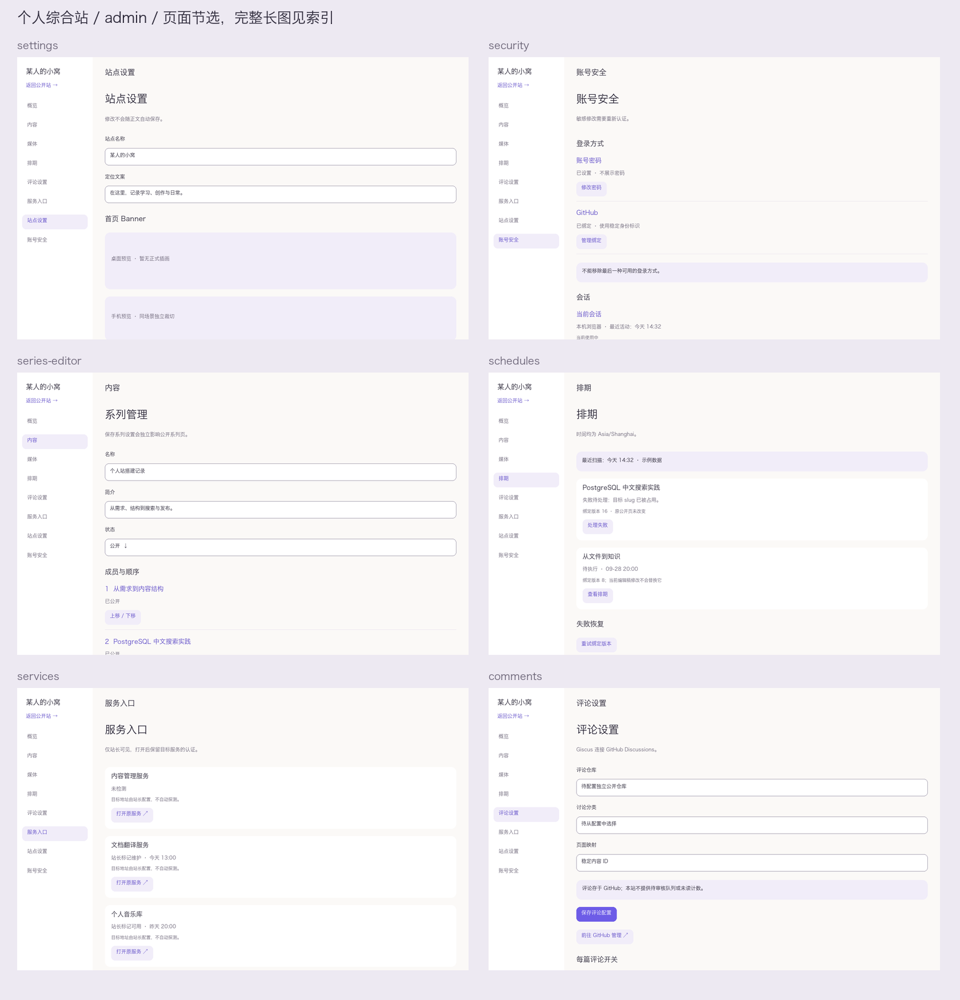

# 个人综合站：静态视觉稿 v2 补充索引

日期：2026-09-26。状态：继续设计审阅，尚未批准完整正式规格。本批新增 63 张静态 PNG，保留 v1 的 48 张核心画板；v2 是覆盖补充，不是综合方案 v2 的重新选型。

## 先看这些

[公开栏目总览](visual-v2/overview-public.png) · [管理页面总览](visual-v2/overview-admin.png) · [边界与导航总览](visual-v2/overview-boundaries.png)

## 新增页面

| 页面 | 桌面 1440 | 手机 375 |
|---|---|---|
| 文章／笔记列表骨架 | [查看](visual-v2/articles-1440-light.png) | [查看](visual-v2/articles-375-light.png) |
| 动态时间线 | [查看](visual-v2/moments-1440-light.png) | [查看](visual-v2/moments-375-light.png) |
| 作品列表 | [查看](visual-v2/projects-1440-light.png) | [查看](visual-v2/projects-375-light.png) |
| 作品详情 | [查看](visual-v2/project-detail-1440-light.png) | [查看](visual-v2/project-detail-375-light.png) |
| 工具目录 | [查看](visual-v2/tools-1440-light.png) | [查看](visual-v2/tools-375-light.png) |
| 工具说明 | [查看](visual-v2/tool-detail-1440-light.png) | [查看](visual-v2/tool-detail-375-light.png) |
| 资源目录 | [查看](visual-v2/resources-1440-light.png) | [查看](visual-v2/resources-375-light.png) |
| 资源说明 | [查看](visual-v2/resource-detail-1440-light.png) | [查看](visual-v2/resource-detail-375-light.png) |
| 公开系列 | [查看](visual-v2/series-1440-light.png) | [查看](visual-v2/series-375-light.png) |
| 公开标签 | [查看](visual-v2/tags-1440-light.png) | [查看](visual-v2/tags-375-light.png) |
| 全部更新 | [查看](visual-v2/updates-1440-light.png) | [查看](visual-v2/updates-375-light.png) |
| 关于与友链 | [查看](visual-v2/about-1440-light.png) | [查看](visual-v2/about-375-light.png) |
| 隐私说明 | [查看](visual-v2/privacy-1440-light.png) | [查看](visual-v2/privacy-375-light.png) |
| 站点设置 | [查看](visual-v2/settings-1440-light.png) | [查看](visual-v2/settings-375-light.png) |
| 账号安全 | [查看](visual-v2/security-1440-light.png) | [查看](visual-v2/security-375-light.png) |
| 系列排序 | [查看](visual-v2/series-editor-1440-light.png) | [查看](visual-v2/series-editor-375-light.png) |
| 标签重命名 | [查看](visual-v2/tags-editor-1440-light.png) | [查看](visual-v2/tags-editor-375-light.png) |
| 排期与失败恢复 | [查看](visual-v2/schedules-1440-light.png) | [查看](visual-v2/schedules-375-light.png) |
| 私有服务目录 | [查看](visual-v2/services-1440-light.png) | [查看](visual-v2/services-375-light.png) |
| 评论设置 | [查看](visual-v2/comments-1440-light.png) | [查看](visual-v2/comments-375-light.png) |
| 不可用页面 | [查看](visual-v2/not-found-1440-light.png) | [查看](visual-v2/not-found-375-light.png) |

## 新增深色画板

| 页面 | 桌面 | 手机 |
|---|---|---|
| 站点设置 | [查看](visual-v2/settings-1440-dark.png) | [查看](visual-v2/settings-375-dark.png) |
| 账号安全 | [查看](visual-v2/security-1440-dark.png) | [查看](visual-v2/security-375-dark.png) |
| 系列排序 | [查看](visual-v2/series-editor-1440-dark.png) | [查看](visual-v2/series-editor-375-dark.png) |
| 排期与失败恢复 | [查看](visual-v2/schedules-1440-dark.png) | [查看](visual-v2/schedules-375-dark.png) |
| 私有服务目录 | [查看](visual-v2/services-1440-dark.png) | [查看](visual-v2/services-375-dark.png) |

## 边界与控件细稿

| 画板 | 链接 | 覆盖含义 |
|---|---|---|
| 首页 320px | [查看](visual-v2/home-boundary-320-light.png) | 完整 6/3/3/3，按可用宽度重新排版 |
| 首页 768px | [查看](visual-v2/home-boundary-768-light.png) | 完整 6/3/3/3，按可用宽度重新排版 |
| 首页 1099px | [查看](visual-v2/home-boundary-1099-light.png) | 完整 6/3/3/3，按可用宽度重新排版 |
| 首页 1100px | [查看](visual-v2/home-boundary-1100-light.png) | 完整 6/3/3/3，按可用宽度重新排版 |
| 手机文字 200% | [查看](visual-v2/text-200-375-light.png) | 静态放大模拟，不等于浏览器缩放测试 |
| 手机菜单 | [浅色](visual-v2/mobile-menu-375-light.png) / [深色](visual-v2/mobile-menu-375-dark.png) | 右侧抽屉、可见遮罩、分组与关闭入口 |
| 主题选项 | [浅色](visual-v2/theme-menu-375-light.png) / [深色](visual-v2/theme-menu-375-dark.png) | 跟随系统／浅色／深色的选项内容示意 |
| 排序／错误／焦点 | [浅色](visual-v2/controls-375-light.png) / [深色](visual-v2/controls-375-dark.png) | 独立上下移动、边界禁用、焦点与错误态并存 |

## 采用哪个画板

- 先看 v1 的完整首页、详情、编辑、发布和媒体，再使用本批补充栏目及管理页面。
- 系列和精选页面内“上移／下移”的概览占位，以本批 controls 细稿为准：必须是两个独立可聚焦按钮，首项上移、末项下移禁用。
- 工作台手机页使用菜单、页面名称和返回入口，不沿用公开站的搜索导航。
- 作品列表桌面以本批修订的左图右文为准，手机图上文下。首版工具目录中的维护项只能进入说明页，不能执行打开工具。
- 主题选项画板只展示选项内容，最终呈现为可关闭选择弹层，不将其误作新增独立主题页面。
- 文章／笔记列表共享骨架但类型、文案、内容独立；笔记详情复用既有阅读框架。动态详情沿用时间线条目及独立链接，默认不显示长文目录。

## 检查与限度

已对 63 张 PNG 执行解码与尺寸核对；绘制阶段检查文字右边界。目视查看公开与后台总览、边界总览、手机深色设置、排序细稿、手机深色抽屉及手机账号安全。修正了手机工作台导航、作品列表横向版式、菜单抽屉和排序按钮的呈现。

本轮没有网页、浏览器或服务器运行验证。静态边界画板不能证明响应式代码、键盘焦点、屏幕阅读器或输入法行为已经通过。上下文文案与服务数据仍为设计样例。

正式日系 Banner、真实作品截图、站名与定位以及目标 Noto Sans SC / Space Grotesk / JetBrains Mono 字体仍未替换；素材和字形验收未完成。少内容、登录过期、上传进行中等未各自铺开成全尺寸 PNG，仍受功能规格、组件状态矩阵与已有错误画板约束，不据图片数量宣称穷尽所有状态。

## 下一阶段边界

当前主要页面结构已具备可视审阅材料，优先集中处理审阅意见，不继续无目的扩增重复画板。最终素材和目标字体决定完成视觉验收；实现阶段才能检查真实交互与性能。完整正式规格尚需用户明确批准，不能将本轮“继续”视为进入 writing-plans 的授权。

